

# MEmory

**同一場活動，每個人帶走的回憶都不一樣。**
 AI 幫你整理你經歷過的片刻，不替你編造回憶。

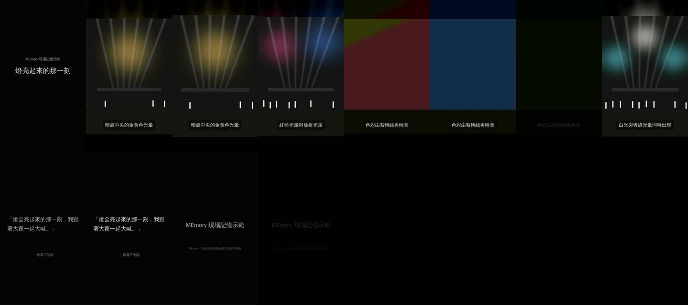

▲ 先前實際產生的範例短片畫格（使用合成的「夜間演唱會」範例素材，經 Claude 分析、FFmpeg 合成）

https://github.com/user-attachments/assets/ae28ab65-1111-41a2-b318-4edc4bd51cda

  

**👉 [https://memory-aipost.up.railway.app/studio](https://memory-aipost.up.railway.app/studio)**

不用安裝、不用登入：選範例素材或上傳自己的照片，寫一句話，約 1 分鐘產生你的回憶短片。

---

## Why MEmory

在 AI 發展如此強勁的時代，我們做了很多幫助工作流的工具、花了很多時間探索科技還能做到什麼，卻也讓人們越來越焦慮自己是不是會被AI取代掉。
於是我也開始思考，身而為人的價值是什麼？是不是哪些事情是因為我們親身經歷過，才具有它的意義？
我記得我在網路上看過一張圖片，文案寫著:「我不好看，重點是背景很漂亮。」而底下有一個留言是這樣的:「這樣的美景我看了許多次，而這是我第一次看見有你的照片。」
即便是同一場演唱會，有人記得的是舞台上的表演，有人記得的是與朋友相處的那段時間，也有人可能在那個晚上重新找到了生活的動力。
我們身處相同的場域，卻有著完全不同的感受與故事。
我認為這些差異本身就很有價值。

## One Event, Different Memories

> 概念示意圖，不是實際使用者資料。

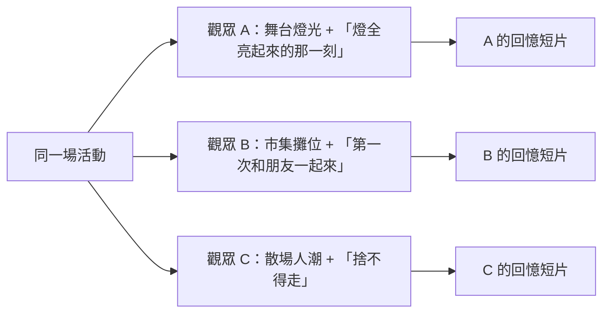

## Product Experience

以下都是實際執行時的畫面（長截圖已切成相同尺寸的段落）。

**觀眾端：回憶工作室**

| ① 活動與素材 | ② 心得、語氣、產生進度 | ③ 產生的短片與 AI 敘事 |
|:---:|:---:|:---:|
| 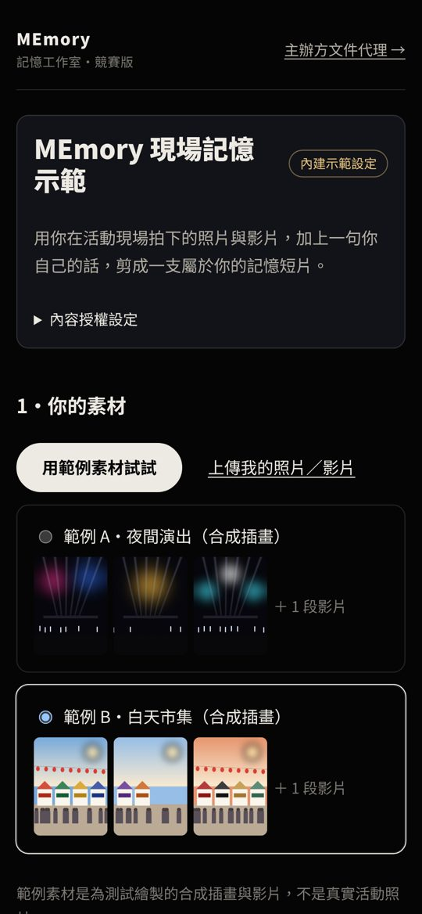 | 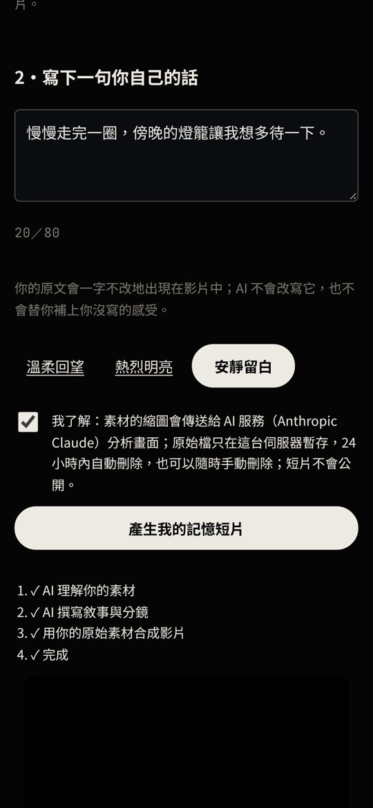 | 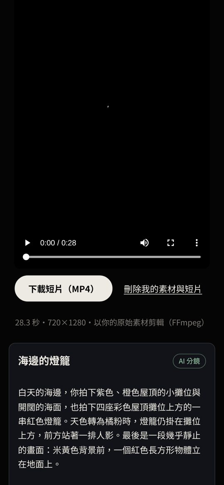 |

**分鏡依據與主辦方文件代理**

| ④ 分鏡表：AI 看到什麼 | ⑤ 主辦方上傳文件 | ⑥ 文件設定套用到觀眾端 |
|:---:|:---:|:---:|
| 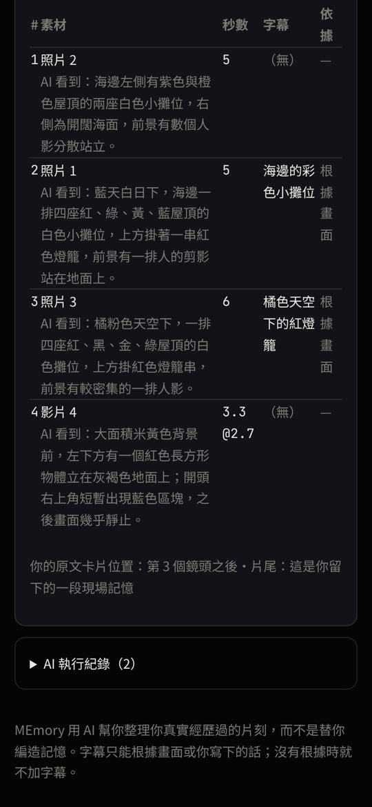 | 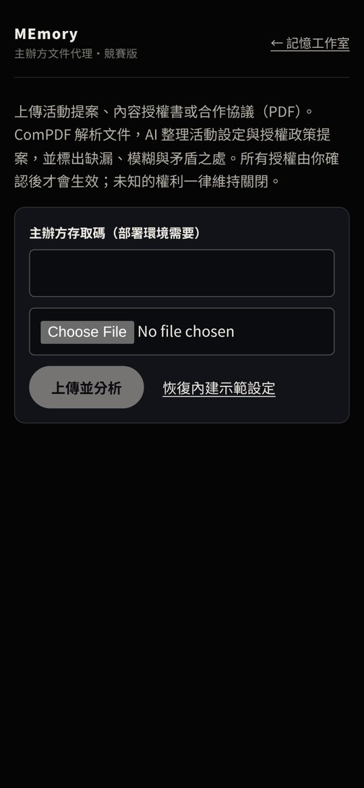 | 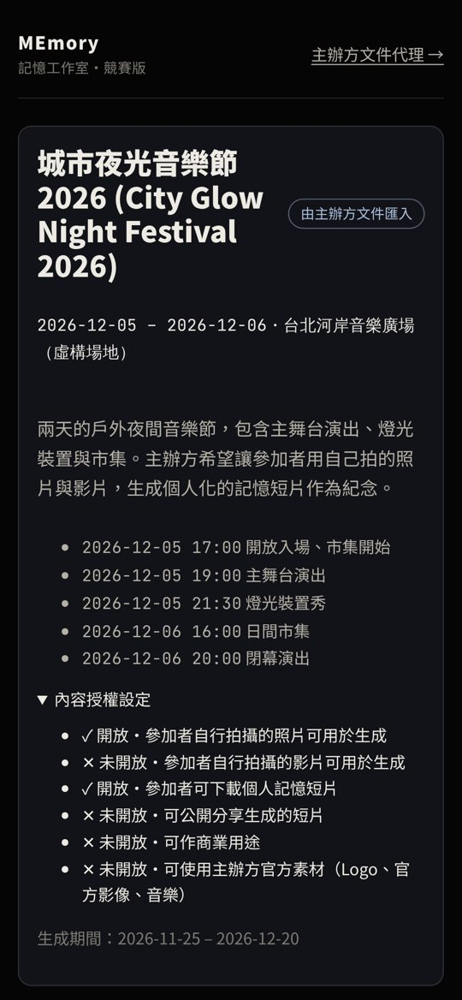 |

端對端測試中產生的短片畫格：

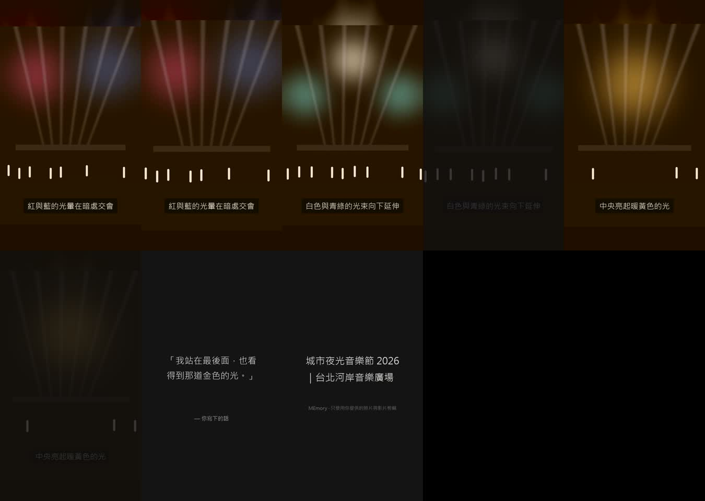

完整長截圖：[工作室](competition/evidence/e2e/studio-phone.png) · [產生結果](competition/evidence/e2e/studio-live-result.png) · [主辦方](competition/evidence/e2e/organizer-phone.png) · [文件設定](competition/evidence/e2e/studio-document-derived-event.png)

## How It Works

### 觀眾端：回憶短片

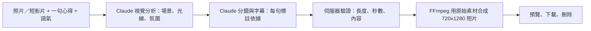

### 主辦方：KDAN 文件代理

在規劃 MEmory 的過程中，我一直在思考如何讓它能被應用到不同國家、不同規模、不同類型的文化活動，同時保留每一個活動本身的特殊性。

但每場活動的企劃、場域資訊、合作方式和內容授權條件都不一樣。如果每次導入都要工程師重新理解文件、客製化開發，這個服務就很難規模化，資源有限的文化活動也很難用上這樣的技術。

所以這次我希望透過 KDAN 的工具，讓 AI 成為主辦方與 MEmory 系統之間的文件代理人：

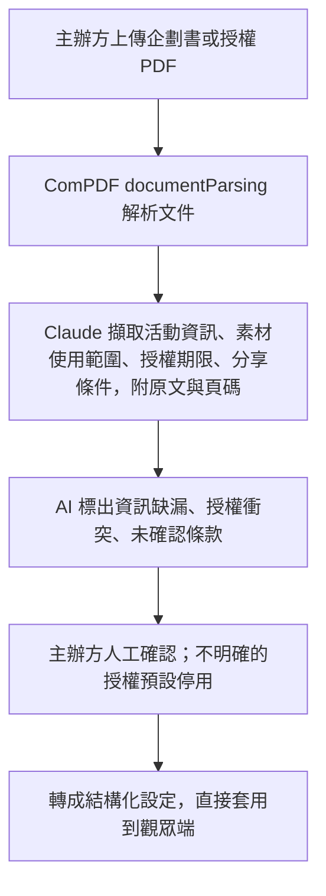

這個流程已經用真實的 ComPDF API 和端對端測試驗證過，從文件輸入一直到活動設定實際生效。我希望 AI 處理完文件後，產出的不只是一份給人讀的摘要，而是產品可以直接使用的結果。

## Engineering Evidence

- **端對端測試：** 在開發者電腦上 8/8 通過，包含 ComPDF 解析、Claude 解讀、人工確認、匯入、依文件規則產生並下載短片（[報告](competition/evidence/e2e/)）。
- **其他測試：** 單元測試 80/80、Playwright 手機版測試 3/3（詳見 [HANDOFF](competition/HANDOFF.md)）。
- **技術：** Next.js、Claude（claude-opus-5-5，備援 claude-sonnet-5-5）、ComPDF documentParsing、FFmpeg。
- **文件：** [完成狀況 HANDOFF](competition/HANDOFF.md) · [驗收對照 ACCEPTANCE](competition/ACCEPTANCE.md) · [證據索引 EVIDENCE_INDEX](competition/EVIDENCE_INDEX.md) · [原始證據](competition/evidence/)

## 試用方式

**線上體驗：[https://memory-aipost.up.railway.app/studio](https://memory-aipost.up.railway.app/studio)**（手機或電腦都可以，不需要帳號）

1. 選「範例素材」，或上傳 2–8 張自己的照片／短影片。
2. 寫一句當下的感受，選一種語氣。
3. 勾選同意，按「產生我的記憶短片」。約 1 分鐘後就能預覽並下載。

主辦方文件流程（`/organizer`）需要主辦方權杖，請參考上方的截圖與 Demo 影片。

## What's Next

音樂祭、地方祭典、展覽、劇場、運動賽事：每一種文化現場都有自己的語言和規則。

**技術負責整理，回憶屬於你。**

---

金鑰不在這個 repo 裡。未授權任何開源授權，保留所有權利，僅供比賽評審檢視。
